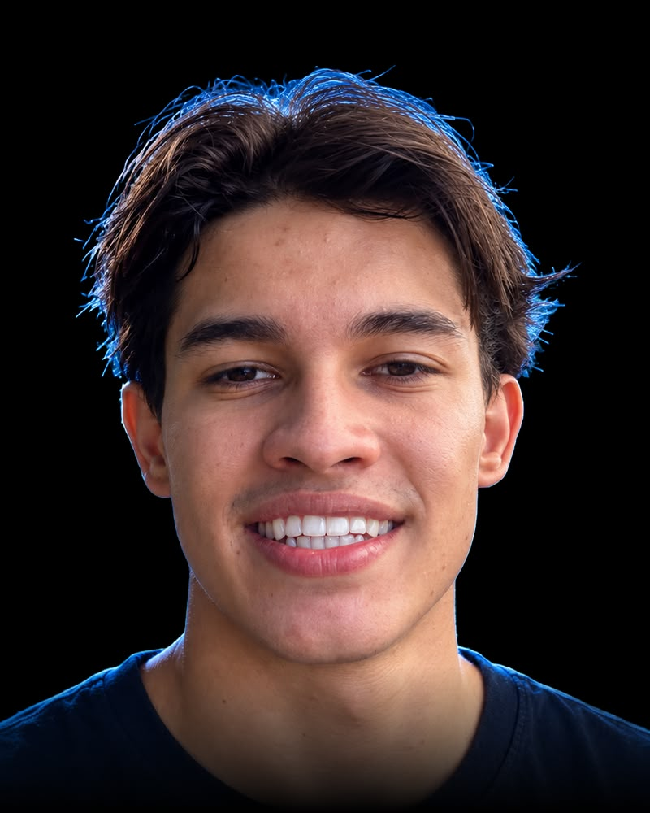
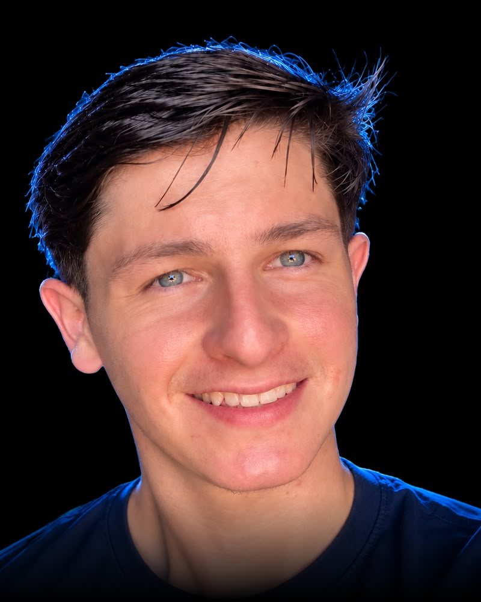

# 🚀 VL Tech — High-Performance Digital Agency

<div align="center">
  
  <br><br>
  <h3><strong>TRANSFORMAMOS TECNOLOGIA EM ESCALA</strong></h3>
  <p><em>Agência de elite focada em desenvolvimento web cinematográfico, automações inteligentes com IA para WhatsApp e direção criativa no Instagram.</em></p>

  <p>
    <a href="#-visão-geral">Visão Geral</a> •
    <a href="#-os-fundadores">Fundadores</a> •
    <a href="#-pilares-de-serviços">Serviços</a> •
    <a href="#-stack-tecnológica">Stack</a> •
    <a href="#-como-executar-localmente">Executar</a> •
    <a href="#-deploy-na-vercel">Deploy Vercel</a>
  </p>
</div>

---

## ⚡ Visão Geral

A **VL Tech** é uma agência de engenharia digital de alto impacto liderada por dois co-fundadores especialistas. O projeto foi desenhado sob a estética e dinamismo dos sites de showcase da **Fórmula 1**:
- **Scrollytelling & Fullscreen Pinning**: A seção dos sócios e serviços transiciona suavemente conforme a rolagem do usuário através do **GSAP ScrollTrigger**.
- **Dynamic Visual Swapping**: Alternância em tempo real da iluminação ambiente (*glow* ciano elétrico vs carmesim neon), badges de telemetria e retratos em alta resolução.
- **Glassmorphism Líquido**: Fundos escuros profundos (`#07070a`), bordas sutis com brilho neon e desfoque óptico (`backdrop-blur-xl`).
- **Simulador Interativo de IA**: Chatbot funcional incorporado com respostas em tempo real simulando a inteligência conversacional no WhatsApp.

---

## 👥 Os Fundadores

<div align="center">
  <table>
    <tr>
      <td align="center" width="50%">
        <br>
        <strong>Luiz Gabriel</strong><br>
        <em>Co-Founder & Head of Tech & AI Architecture</em><br>
        <code>GSAP • WebGL • Vercel Edge • WhatsApp Cloud API</code>
      </td>
      <td align="center" width="50%">
        <br>
        <strong>Vitor</strong><br>
        <em>Co-Founder & Head of Growth & Creative Direction</em><br>
        <code>Reels Cinematográficos • Design Systems • Copywriting Neuro-persuasivo</code>
      </td>
    </tr>
  </table>
</div>

---

## 🛠️ Pilares de Serviços (The 3 Core Pillars)

1. **High-Performance Web Development & Landing Pages**
   - Código 100% sob medida, sem construtores lentos ou plugins pesados.
   - Animações fluidas a 60 FPS com GSAP 3 e WebGL.
   - Deploy com latência mínima no Vercel Edge Network (< 800ms).

2. **Instagram Content Creation & Gestão Estratégica**
   - Produção e edição cinematográfica de Reels no padrão documentário/publicitário.
   - Design System proprietário para alinhamento e autoridade no feed.
   - Roteiros e ganchos neuro-persuasivos para converter seguidores em clientes.

3. **Automated Support & AI Chatbots (WhatsApp & CRM)**
   - Agentes de Inteligência Artificial autônomos operando 24 horas por dia.
   - Conexão oficial à WhatsApp Cloud API (sem risco de banimentos).
   - Treinamento customizado com a base de conhecimento da empresa e agendamento instantâneo.

---

## 💻 Stack Tecnológica

- **Frontend**: HTML5 Semântico, Vanilla JavaScript (ES6+)
- **Estilização**: Tailwind CSS + Custom CSS Design System (`styles.css`)
- **Animações & Motion**: GSAP 3 (GreenSock), ScrollTrigger, ScrollToPlugin
- **Ícones**: Lucide Icons
- **Tipografia**: [Syne](https://fonts.google.com/specimen/Syne) (Display) & [Inter](https://fonts.google.com/specimen/Inter) (Interface)
- **Áudio Feedback**: Web Audio API Synthesizer (som tátil nativo sem arquivos externos)
- **Deploy**: Vercel Edge Ready (`vercel.json`)

---

## 📂 Estrutura de Arquivos

```bash
VLTech/
├── assets/
│   ├── logo/
│   │   ├── logo.jpeg
│   │   └── vl-logo.jpg
│   └── socios/
│       ├── luiz-dark.jpg
│       ├── vitor-dark.jpg
│       ├── luiz-studio.jpg
│       └── vitor-studio.jpg
├── index.html        # Estrutura completa e semântica com Tailwind e GSAP
├── styles.css        # Efeitos de vidro, neon, HUD brackets e animações
├── main.js           # Lógica do scrollytelling, canvas, chatbot e áudio
├── vercel.json       # Otimização de cache e segurança para deploy Vercel
└── README.md         # Documentação completa
```

---

## 🖥️ Como Executar Localmente

Como o projeto é construído em padrões web modernos e estáticos:

1. **Abrir diretamente**: Basta dar um duplo-clique no arquivo `index.html` em seu navegador favorito (Chrome, Edge, Firefox, Safari).
2. **Via Live Server (VS Code / IDE)**:
   - Clique com o botão direito no `index.html` e selecione **"Open with Live Server"**.
3. **Via Navegador**:
   ```text
   file:///C:/Users/luiz.moraes/Desktop/Projetos/VLTech/index.html
   ```

---

## 🌐 Deploy na Vercel

O projeto está 100% preparado para ser colocado em produção na **Vercel** com apenas alguns cliques:

### Método 1: Via Vercel Dashboard (Recomendado)
1. Acesse [vercel.com](https://vercel.com) e faça login com sua conta do GitHub.
2. Clique em **"Add New..."** > **"Project"**.
3. Selecione o repositório `Luiz-Gabriel-m/VL_Tech`.
4. Mantenha as configurações padrão (Framework Preset: **Other** / Root Directory: `./`).
5. Clique em **"Deploy"**. Seu site estará no ar globalmente com SSL e CDN em menos de 1 minuto!

### Método 2: Via Vercel CLI
```bash
# Instalar a CLI (caso tenha node):
npm i -g vercel

# Na pasta do projeto:
vercel --prod
```

---

## 🔒 Licença & Direitos

© 2026 **VL Tech**. Todos os direitos reservados.  
Desenvolvido com excelência por **Luiz Gabriel** & **Vitor**.
